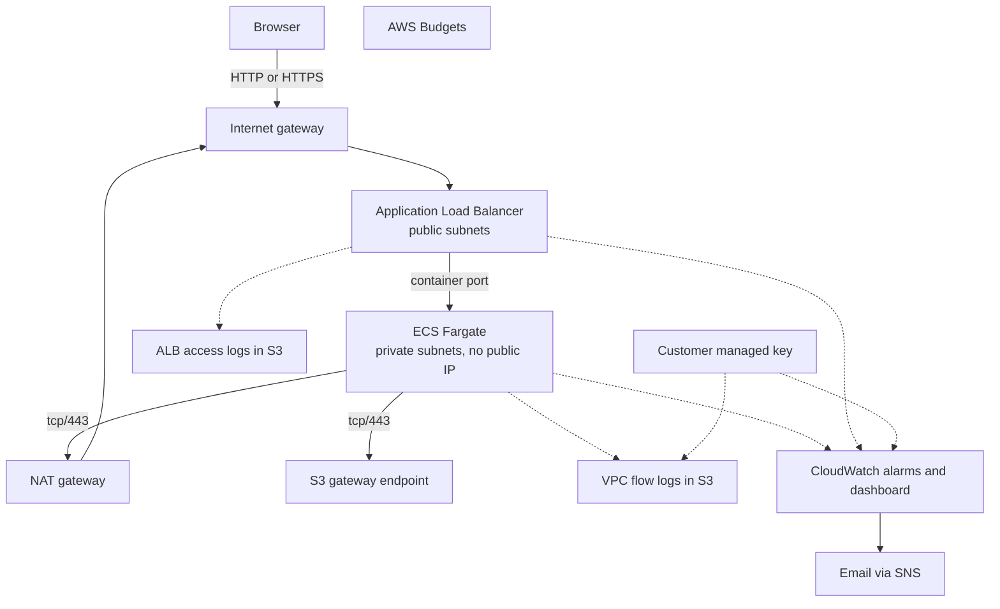
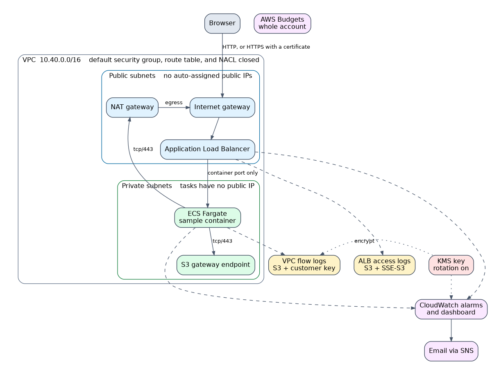

# secure-aws-platform

A small AWS platform for a portfolio review: a public load balancer, a private Fargate service, encryption, alarms, and a cost ceiling. It is a reference design by Muhammad Ayaz ([AyazAI](https://github.com/AyazAI)). It has not been applied to an AWS account. There is no live URL and there are no screenshots.

The problem it is meant to show is a common one. A single container still needs a network boundary, a task role that cannot do much, encrypted logs, and a bill that pages someone before it grows. This repository is that slice. It is not a multi-account landing zone, and it does not claim a production deployment.

## Architecture





The PNG is generated by [`docs/architecture.py`](docs/architecture.py) with Graphviz. Regenerate it with `python3 docs/architecture.py`.

## Stack

| Piece | Choice |
| --- | --- |
| Network | VPC, two public and two private subnets, one NAT gateway by default |
| Edge | Application Load Balancer. HTTP until you pass an ACM certificate ARN |
| Compute | ECS on Fargate, ARM64, 0.25 vCPU and 0.5 GB in the demo shape |
| Image | Public nginx so a task can start, plus [`sample-app/`](sample-app/) to push later |
| Identity | Execution role can pull from one ECR repository and write one log group. Task role has no permissions |
| Encryption | One customer managed key with rotation. ALB access logs stay on SSE-S3 because that is what ALB log delivery supports |
| Detection | VPC flow logs, five CloudWatch alarms, one dashboard |
| Cost | One account-wide monthly budget with email thresholds |
| State | Local by default. [`terraform/backend.tf.example`](terraform/backend.tf.example) is an example remote backend and is not active |

Fargate is the compute choice so the demo does not pay for EKS control-plane hours.

## Security decisions

- Tasks run in private subnets with `assign_public_ip = false`. Execute command is off.
- The load balancer security group may receive internet traffic on port 80, and on 443 only when `acm_certificate_arn` is set. Its only egress is the container port on the task security group.
- The task security group accepts that container port only from the load balancer. Egress is tcp/443, the S3 prefix list, and DNS to the VPC CIDR.
- The default security group, the default route table, and the default network ACL are emptied. Subnets use their own tables and ACLs.
- Public subnets do not auto-assign public IPv4 addresses. The load balancer and the NAT gateway have their own addresses.
- The task role has no identity policy. The sample container does not call AWS.
- The execution role may call `ecr:GetAuthorizationToken` on `*`, because that API has no repository ARN, and may pull only the repository this stack creates.
- Flow logs use the customer managed key. ALB access logs use SSE-S3.
- Container Insights is off. The alarms use standard ECS and ALB metrics.
- One NAT gateway is the demo default. `single_nat_gateway = false` places one in each availability zone. Either way, tasks have a path to the internet on tcp/443. That is the trade for pulling a public image without interface endpoints. See the cost section for the hourly comparison.
- No private key and no password is generated in Terraform. HTTPS is enabled by passing an ACM certificate ARN you already have.
- The budget covers the whole payer account, not only resources with this stack's tags. Other spend in the account counts toward it.

Checks that cannot be satisfied without changing those decisions are skipped on the resource, with the reason in the same file. There is no global ignore file.

## How to run the checks

You need Terraform 1.17.2, tflint 0.66.0, Checkov 3.4.5, tfsec 1.28.14, and gitleaks 8.30.1. The workflow [`.github/workflows/ci.yml`](.github/workflows/ci.yml) installs those versions. It has `contents: read` only. It does not configure AWS credentials and it does not run `plan` or `apply`.

```bash
make security
```

That runs `terraform fmt -check`, `terraform init -backend=false`, `terraform validate`, tflint, Checkov, tfsec, and gitleaks. `terraform init` downloads the AWS provider. It does not need AWS credentials.

Copy an example file only when you are reviewing a plan in your own account:

```bash
cp environments/demo.tfvars.example terraform/demo.auto.tfvars
```

`terraform/demo.auto.tfvars` is gitignored. Replace `alert_email` before any real apply. `budget-alerts@example.com` is a documentation address and does not receive mail.

Do not run `terraform plan` or `terraform apply` from the static-check workflow. A plan talks to AWS.

### Manual plan or apply

[`.github/workflows/terraform-deploy.yml`](.github/workflows/terraform-deploy.yml) is `workflow_dispatch` only. Nothing in this repository has dispatched it.

Before you dispatch it:

1. Create a GitHub Environment named `aws-deploy`. Add a required reviewer if you want a second click.
2. Set the repository variables `AWS_DEPLOY_ROLE_ARN` and `AWS_REGION`.
3. Create an IAM OIDC provider for `token.actions.githubusercontent.com` and a role that trusts this repository only. The workflow assumes that role. It does not contain the role ARN.
4. For apply, copy `terraform/backend.tf.example` to `terraform/backend.tf`, replace every `REPLACE_ME`, and create that bucket and lock table outside this stack. Do not commit `backend.tf`. Apply refuses to start without an `s3` backend block.
5. Pass a real `alert_email` when you dispatch. The workflow rejects an `@example.com` address.

The trust policy should restrict `token.actions.githubusercontent.com:sub` to `repo:AyazAI/secure-aws-platform`. The role you attach needs permission to create this stack and `iam:PassRole` on the two ECS roles. This repository does not ship that policy.

### Sample container

[`sample-app/`](sample-app/) is nginx, listening on 8080 as a non-root user, with `/healthz`. The demo variable file uses `public.ecr.aws/nginx/nginx:1.27-alpine` on port 80 so a task can become healthy before you push anything.

To run the sample image instead, build it, push it to the ECR repository in the `ecr_repository_url` output, and set:

```hcl
container_image          = "<ecr_repository_url>:1.0.0"
container_port           = 8080
health_check_path        = "/healthz"
container_user           = "101"
readonly_root_filesystem = true
```

Tags on that repository are immutable, and images are scanned on push.

## Estimated cost

This is an estimate, not a quote and not a bill. Nothing here has been deployed, so there is no measured usage. The idle totals are list price times the hours a resource exists. They assume the resource runs the whole period and that nobody sends traffic.

Rates were read on 17 November 2026. A month is 730 hours (365 / 12 × 24). A day is 24 hours. The arithmetic is [`docs/cost_estimate.py`](docs/cost_estimate.py). Run `python3 docs/cost_estimate.py` to reproduce the totals.

| Rate | Published value | Source |
| --- | --- | --- |
| Fargate Linux/ARM | $0.0000089944 per vCPU-second and $0.0000009889 per GB-second | [Fargate pricing](https://aws.amazon.com/fargate/pricing/), US East (N. Virginia) examples. Billing is per second with a 1-minute minimum. 20 GB of ephemeral storage is included. |
| Application Load Balancer | $0.0225 per hour, partial hours billed as a full hour, plus $0.008 per LCU-hour | [Elastic Load Balancing pricing](https://aws.amazon.com/elasticloadbalancing/pricing/), US-East-1 examples |
| NAT gateway | $0.045 per hour and $0.045 per GB processed | AWS price list, US East (N. Virginia), [NAT gateway price map](https://b0.p.awsstatic.com/pricing/2.0/meteredUnitMaps/ec2/USD/current/natgateway.json) |
| Public IPv4 | $0.005 per in-use address per hour | AWS Price List offer `AmazonVPC` `20261117011403`, us-east-1, `USE1-PublicIPv4:InUseAddress`. The ELB pricing example counts two addresses for one load balancer. |
| KMS | $1 per customer managed key per month, prorated hourly | [KMS pricing](https://aws.amazon.com/kms/pricing/). The first and second automatic rotation each add $1 per month, capped after the second. A new key has not rotated yet. |
| Interface VPC endpoint | $0.01 per endpoint-hour | Same VPC price list, `USE1-VpcEndpoint-Hours`, plus $0.01 per GB for the first petabyte |

The demo shape is one ARM task at 0.25 vCPU and 0.5 GB, one load balancer, one NAT gateway, three public IPv4 addresses (two for the load balancer, one for the NAT gateway), and one KMS key.

| Idle charge | Per day | Per 730-hour month |
| --- | --- | --- |
| Fargate | $0.2370 | $7.2087 |
| Load balancer hours | $0.5400 | $16.4250 |
| NAT gateway hours | $1.0800 | $32.8500 |
| Public IPv4 | $0.3600 | $10.9500 |
| KMS key | $0.0329 | $1.0000 |
| **Idle total** | **$2.2499** | **$68.4337** |

So a quiet demo left running is about **$2.25 per day** and **$68.43 per month** before usage-based charges. The NAT gateway is about half of that monthly total.

The production-shaped example (`environments/production.tfvars.example`) is two tasks at 0.5 vCPU and 1 GB, two NAT gateways, and four public IPv4 addresses. The same rates give **$4.1609 per day** and **$126.5599 per month** idle. That file is a larger example, not a statement that it is running.

These usage-based prices are real and are **not** in the idle total, because this stack has no measured bytes:

| Usage | Unit price | Source |
| --- | --- | --- |
| NAT data processing | $0.045 per GB | NAT price map above |
| Load balancer capacity units | $0.008 per LCU-hour | ELB pricing page above. With 10 or fewer rules, the rule-evaluation dimension is ignored. |
| Flow logs delivered to S3 | $0.25 per GB for the first 10 TB | CloudWatch price list offer `20261116194620`, us-east-1, `USE1-S3-Egress-Bytes`. This stack uses plain text, so it does not add the $0.03 per GB Parquet conversion rate in that same file. |
| S3 Standard storage | $0.023 per GB-month for the first 50 TB | S3 price list offer `20261116211745`, us-east-1 |
| Application log ingestion | $0.50 per GB | Same CloudWatch price list, `USE1-DataProcessing-Bytes`. The pricing-page examples treat the first 5 GB in a month as $0. |
| Application log storage | $0.03 per GB-month | Same file, `USE1-TimedStorage-ByteHrs`. Examples treat the first 5 GB stored as $0. |
| ECR storage, after you push an image | $0.10 per GB-month | ECR price list offer `20261113163947`, us-east-1 |
| Standard-resolution alarms | $0.10 per alarm-metric-month | Same CloudWatch file, `CW:AlarmMonitorUsage` |
| Budgets without actions | $0 | [AWS Budgets pricing](https://aws.amazon.com/aws-cost-management/aws-budgets/pricing/) |

The five alarms and the one dashboard sit inside the published free allowance of 10 standard alarm metrics and 3 custom dashboards (up to 50 metrics each) on the [CloudWatch pricing](https://aws.amazon.com/cloudwatch/pricing/) page. The us-east-1 CloudWatch price list file above has no custom-dashboard SKU, so this estimate uses $0 for the dashboard. If the account already uses that free allowance, extra standard alarms are $0.10 per alarm-metric-month. ECS service CPU and memory metrics used here are the standard metrics the same page prices at no extra charge. Data transfer out of the region is not in the total. Use the EC2 data-transfer price list for the region you actually pick.

A new AWS account may also have the load balancer free tier on that ELB page (750 hours and 15 LCUs, shared with Classic Load Balancer hours). This estimate does not assume the account is new, so the load balancer hours are included in full.

Replacing the NAT gateway with interface endpoints for ECR API, ECR DKR, and CloudWatch Logs, in two availability zones, is 6 × $0.01 × 730 = **$43.80 per month** in endpoint hours, before the $0.01 per GB data charge. One NAT gateway is $32.85 in hours. The demo keeps the NAT gateway. Pulling `public.ecr.aws` still needs a path to the public registry, which those interface endpoints do not provide. The S3 gateway endpoint in this stack has no hourly charge; the [VPC pricing](https://aws.amazon.com/vpc/pricing/) page says gateway endpoints have no hourly or data-processing charge.

The demo budget limit is $100. That number is a ceiling chosen above the $68.43 idle estimate so a quiet month does not page on the idle total alone. It is not a price.

## Teardown

From `terraform/`, with the same variable file you applied:

```bash
terraform destroy
```

The demo file sets `enable_deletion_protection = false` and `force_destroy_buckets = true`, so the load balancer and the log buckets can be deleted. The production-shaped example turns deletion protection on and refuses to force-delete buckets. Turn those back before destroy, or destroy will stop.

KMS deletion uses a 7-day window. [KMS pricing](https://aws.amazon.com/kms/pricing/) says a key that is scheduled for deletion is not charged during the waiting period. Public IPv4 addresses, the NAT gateway, the load balancer, and Fargate stop billing when those resources are gone. Confirm that in Cost Explorer after destroy. The budget itself remains until `terraform destroy` deletes it. It has no actions, so it is in the free Budgets tier.

## Live demo

Not deployed.

- URL: add the `alb_dns_name` output here after a real apply.
- Screenshots: add them after a real apply.

## What this stack leaves out

WAF, GuardDuty, Security Hub, AWS Config, a database, and interface VPC endpoints are not in this repository. They are real controls, and they are separate line items. They are omitted so the module set stays small enough to read and so the idle cost above stays tied to resources that are actually declared.
